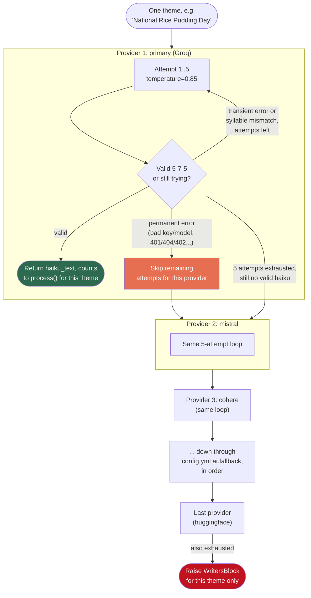

# AI Backend — Multi-Provider Fallback Chain

How haiku generation actually calls an AI, why it's not just one provider, and
how to test/extend it without risking a live post to real subscribers/socials.

## Why this exists

GitHub Models (the original free AI backend) was fully retired 2026-07-30 with
no warning, which silently zeroed out haiku generation for 10 days before
anyone noticed (see `state/run_log/` history around 2026-07-31). The fix
wasn't "pick a new provider" — free AI provider tiers turned out to be
individually unreliable (deprecated models, shared-pool rate limits, quota
quirks). The real fix was: **never depend on just one provider again**, plus
an immediate email alert if a day still produces zero haikus despite that.

## The cascade



This whole cascade runs **once per theme**, independently. A theme that
succeeds on the primary provider never touches the fallback chain. A theme
that fails on the primary tries every fallback in order before it's marked
writer's block — see [Writer's Block Handling](writers-block.md) for what
happens after that (fallback theme, `state/writers_block/` logging, etc).

Code: `_generate()` in `plugins/engines/clambakesanta.py` runs the cascade;
`_providers()` in the same file builds the ordered list from config + env vars.

## Current provider chain

Ordered by confidence, in `config.yml` under `ai.fallback` (primary is set by
`ai.model` + `CBS_AI_KEY`/`CBS_AI_BASE_URL` env vars, not the fallback list).

| # | Provider | Status (as of 2026-11-08) | Model | Notes |
|---|---|---|---|---|
| 1 | **Groq** (primary) | ✅ Working | `openai/gpt-oss-20b` | Unchanged — isolation test (forced via `GROQ_API_KEY`) resolved 2/3 themes directly on primary (empty-content/`finish_reason=length` hiccups and a syllable mismatch, all auto-retried fine); the 3rd theme exhausted primary (more empty-content hiccups + mismatches) and fell through the chain to Pollinations. Same pattern as every previous round |
| 2 | **Mistral** | ❌ Still failing | `mistral-small-latest` | Unchanged since 2026-09-27 — every attempt across all test runs this round (whole-chain + isolation) still gets an immediate `429 rate_limited`. Still looks like account-level quota exhaustion. Not fixable via config — check the Mistral console for remaining quota/plan status |
| 3 | **Cohere** | ⚠️ Still degraded | `command-r7b-12-2024` | Unchanged since 2026-09-27 in real fallback-chain use — whole-chain test still gets HTTP 200 on every call but syllable validation fails almost every attempt ("got unknown" or an off count). **New this round**: Cohere's own isolation test (forced via `ai_key_secret`) now gets a hard `422 "reasoning_effort 'medium' and 'low' are not supported. Use 'high' instead"` on every attempt — Cohere's API appears to now strictly validate that param where it previously tolerated it. This does **not** affect production: `config.yml`'s cohere entry correctly has no `reasoning_effort` set, so the real fallback chain never sends it. It only breaks the isolation-test method itself, because `_providers()` always defaults `reasoning_effort="low"` onto whatever is forced into the `primary` slot, regardless of whether that provider is a reasoning model (see note added to rule 1 below). Also saw several `429 "Trial key limited to 20 API calls/minute"` responses this round that weren't seen before — likely an artifact of this round testing all 9 providers concurrently (shared `COHERE_API_KEY` hit by several simultaneous jobs), not a steady-state change; re-verify with a non-concurrent run if a clean read is needed |
| 4 | **Cerebras** | ❌ Still blocked | `gpt-oss-120b` | Unchanged since 2026-08-17 — every call across all test runs this round still returns `402 payment_required`. Still no payment method on file. Not fixable via config |
| 5 | **OpenRouter** | ⚠️ Still unreliable | `google/gemma-4-31b-it:free` | Unchanged — `:free` model still routes through a congested shared pool, 429'd (mix of generic "Provider returned error" and explicit "Rate limit exceeded: free-models-per-min") on nearly every attempt across all test runs this round. Not fixable by retrying |
| 6 | **Pollinations** | 🟢 Recovered | `openai` | **Status change from last round's "⚠️ Newly degraded"**: back to succeeding on attempt 1/5 in every cascade position observed this round — the whole-chain test resolved all 3 themes cleanly, and it also resolved cleanly every time another provider's isolation test fell through to it. No repeat of last round's deterministic per-theme wrong-syllable response. Its own isolation test did hit one `402 "Free limit reached: 1 reply every 45 seconds per IP"` (correctly fast-skipped as permanent) and one theme repeated the same `5-7-6` mismatch across all 5 retries when hit as `primary` before succeeding cleanly moments later via its normal fallback-list slot — consistent with the anonymous tier being sensitive to being hit twice in quick succession, which this round's concurrent dispatch of 9 isolation tests partly induced rather than reflecting ordinary daily-run behavior. **Not fixable via config** — this is Pollinations' own anonymous-tier behavior. Recommendation for the user, unchanged: a `POLLINATIONS_API_KEY` ("pollen key") would likely remove the 45s/IP limit; adding a new secret is outside this routine's scope |
| 7 | **Gemini** | ⚠️ Reachable, slow | `gemini-3.8-flash` | Model id still valid (no 404s). Resolved all 3 themes this round (an improvement over last round's mix of syllable mismatches/503/429 failures), but every theme needed a `503 Service Unavailable` retry that took **2–3 minutes** to clear before succeeding — the isolation-test job ran 8m17s total vs. ~1–2 min for every other provider. This is the same class of risk already flagged in rule 9 below (no request timeout on the OpenAI client): not a full indefinite hang this round, but a severe latency cliff on Gemini's free tier that could meaningfully slow (though not necessarily break, since Gemini sits near the end of the chain) the real daily run if it's reached. Not fixed as part of this config/doc-only audit — the same `timeout=` fix noted in rule 9 would help here too |
| 8 | **Fireworks** | ✅ Working | `accounts/fireworks/models/gpt-oss-120b` | Unchanged since the 2026-09-27 model-id fix — succeeded every single time it was reached across all test runs this round (3 themes, each on attempt 1/5 or 2/5, total job under 15s), no syllable mismatches |
| 9 | **HuggingFace** | 🔴 Still failing | `meta-llama/Llama-3.1-8B-Instruct` | Unchanged since the 2026-10-11 regression — re-confirmed via a dedicated isolation test this round: still `402 Payment Required` on every attempt, correctly fast-skipped as a permanent failure. This is HuggingFace's own router billing, not a model-id or config issue. **Not fixable via config** — needs the user to either wait for the monthly free-credits reset, buy pre-paid credits, or subscribe to PRO |

Removed entirely (tried, deliberately dropped — see git log for
`config.yml` around 2026-08-09/10 for the full reasoning):

- **OpenAI** — worked once the key was rotated, but $0 billing credits; not worth funding as a backstop when 6+ other providers already work for free
- **Together** — free credits exhausted
- **DeepSeek** — no free tier at all, real balance required
- **SambaNova** — requires a payment method on file even at $0 spend

Not wired in at all:

- **Cloudflare Workers AI** — different request/response shape, not
  OpenAI-compatible, would need real code changes plus an account ID we don't
  pass around
- **Ollama** (local) — GitHub Actions runners can't reach a home machine
  without a public tunnel (ngrok/Cloudflare Tunnel), which would make the
  daily run depend on that machine being powered on and online every morning

## The rules (hard-won, 2026-08-09/10)

1. **`reasoning_effort` is provider-specific, never send it blindly.**
   Reasoning models (Groq/Cerebras `gpt-oss-*`) will silently burn their
   entire `max_tokens` budget on hidden chain-of-thought and return **empty
   content** at default effort — looks like a dead API, not a config issue,
   unless you know to check `finish_reason`. Setting `reasoning_effort: low`
   fixes it. But sending that same parameter to Mistral or Cohere gets a hard
   `400`/`422` — they don't support `"low"`/`"medium"` at all. Solution: set
   `reasoning_effort` per-provider in `config.yml` (only where needed), never
   as a blanket default. See `providers[i]["reasoning_effort"]` in
   `_providers()`.

   **Caveat discovered 2026-11-08**: `_providers()` builds the `primary`
   slot with `"reasoning_effort": ai_config.get("reasoning_effort", "low")`
   — i.e. it **always** defaults to `"low"` for whatever is forced into
   `primary` via the Test AI Backend workflow's `ai_key_secret` override,
   regardless of whether that provider is actually a reasoning model. This
   doesn't affect the real fallback chain (each `ai.fallback` entry's own
   `reasoning_effort` is read from its own dict, which is `None` for
   Mistral/Cohere/OpenRouter/Pollinations/HuggingFace), but it does mean an
   **isolation test** of a non-reasoning provider can fail purely because of
   this default — e.g. Cohere's isolation test started getting a hard `422`
   ("reasoning_effort 'medium' and 'low' are not supported") once Cohere's
   API began strictly validating the param. Worth fixing in `_providers()`
   (e.g. only default `reasoning_effort` for primary when the model name
   matches a known reasoning-model pattern) — left for the user's call since
   it's a code change beyond a config/doc-only audit.

2. **A `400`/`401`/`402`/`404` from a provider is a config problem, not a
   flaky API — don't retry it 5 times.** `_is_permanent_failure()` matches
   on these (plus balance/quota-zero phrases) and breaks out of that
   provider's retry loop immediately, moving to the next provider. Without
   this, a single misconfigured provider wastes ~5x its own latency on every
   theme, every run, forever.

3. **Model IDs go stale fast — verify against the provider's live docs, not
   memory.** Every provider we manually configured a model for got it wrong
   at least once (Cerebras twice). When a provider 404s with "model not
   found" or similar, don't just guess a different name — fetch that
   provider's actual current model list.

4. **Error text can be misleading.** HuggingFace's 400 said "not supported by
   any provider you have enabled" — reads like an account setting is missing.
   It isn't; HF's router auto-selects across all providers by default. The
   real issue was the model just isn't hosted anywhere on their router. Read
   docs before acting on an error message's implied fix.

5. **`optional_key: true` exists for providers that work anonymously**
   (Pollinations). Don't skip a provider just because no secret is
   configured for it if its own docs say auth is optional.

6. **Testing burns real, finite quota.** Several providers (HuggingFace,
   Together, Fireworks' $1 credit) have small enough free allowances that a
   single afternoon of manual testing can exhaust them for the rest of the
   month. Prefer `--engine-only` test runs (below) over repeated live
   `daily.yml` triggers, and don't re-test a provider that already passed
   just to double-check.

   **Caveat discovered 2026-11-08**: dispatching every provider's isolation
   test concurrently (all at once, rather than one at a time) means several
   jobs hit the *same* shared secret simultaneously (every job's env block
   wires in all fallback keys, not just the one being isolated). This round
   that produced extra `429`s on Cohere/OpenRouter that look like genuine
   degradation but are really concurrency contention. Either accept that
   noise and note it in the write-up (as done this round), or space
   isolation-test dispatches out instead of firing all 9 at once.

7. **A GitHub Actions run "succeeding" (`conclusion: success`) does NOT mean
   haikus posted.** The runner intentionally marks a zero-haiku day as
   "complete" to avoid retry-spam — so no Actions failure notification ever
   fires on its own. The `state/run_log/` entry's `haikus_posted` count is
   the only reliable signal, plus the failure-alert email described below.

8. **`ai_key_secret` in Test AI Backend must be the repo *secret name*, not
   the `CBS_AI_KEY` env var it maps to.** The workflow does
   `secrets[inputs.ai_key_secret]` — pass `ai_key_secret="CBS_AI_KEY"` and it
   silently resolves to nothing (repo has no secret literally named that),
   logged as "no API key set" and easy to mistake for primary being broken.
   Primary Groq's actual secret is `GROQ_API_KEY` (see `daily.yml`'s env
   block) — pass `ai_key_secret="GROQ_API_KEY"` to test it in isolation.

9. **No request timeout is set on the OpenAI client — a stalled connection
   can hang a run indefinitely with zero log output.** `_generate()` builds
   `client = OpenAI(base_url=provider["base_url"], api_key=provider["api_key"])`
   with no `timeout=`. Observed during the 2026-10-25 audit: a Gemini
   isolation run fell through to Cohere, and a single retry to Cohere's API
   sat with no response and no error for 20+ minutes before the GitHub
   Actions run had to be cancelled manually — no timeout ever fired. The
   same gap exists in the real `daily.yml` run, so a provider that accepts
   the connection but never answers could, in theory, stall the whole daily
   run rather than fail fast into the next fallback. Not fixed as part of a
   config/doc-only audit — fixing it means adding an explicit per-request
   `timeout=` to the `OpenAI(...)` client in `plugins/engines/clambakesanta.py`,
   a code change left for the user's call.

10. **This weekly audit doesn't require the `gh` CLI specifically — any
    GitHub Actions API access (e.g. the GitHub MCP tools available in a
    Claude Code cloud session) works the same way: trigger
    `workflow_dispatch` on `test_ai_backend.yml` with the same inputs, then
    read the run's job logs.** If `gh auth status` fails in whatever
    environment is running this check, that's not automatically a blocker —
    confirm there's no other path to the Actions API before giving up on
    testing.

## How to test

**Never trigger `daily.yml` (the real "Daily Haiku Generation" workflow) just
to test a provider** — a successful run posts to Mastodon, Bluesky, Tumblr,
Telegram, WordPress, and emails every subscriber. Use one of these instead:

### 1. Test one specific provider (safe, no posting)

Actions → **Test AI Backend** → Run workflow, or:

```bash
gh workflow run "Test AI Backend" --ref main \
  -f ai_key_secret="CEREBRAS_API_KEY" \
  -f ai_base_url="https://api.cerebras.ai/v1" \
  -f ai_model="gpt-oss-120b"
```

Forces that provider as `primary` via `CBS_AI_KEY`/`CBS_AI_BASE_URL`/
`CBS_AI_MODEL`, runs `python run.py --force --regenerate --engine-only`
(engine only — every adapter is skipped, nothing is posted or emailed
anywhere), and logs pass/fail per theme.

### 2. Test the whole fallback chain for real

Same workflow, leave `ai_key_secret` blank:

```bash
gh workflow run "Test AI Backend" --ref main -f ai_key_secret=""
```

Every fallback secret is already wired into that workflow's env block, so
`config.yml`'s `ai.fallback` list runs exactly as it would on the real daily
run — except primary (Groq) is intentionally unset, so it skips straight to
the fallback chain. Useful for confirming the cascade order and catching a
newly-broken provider.

### 3. Test a provider that needs no key, fully locally

If a provider works anonymously (like Pollinations), you don't need GitHub
Actions at all:

```bash
python3 -c "
from openai import OpenAI
client = OpenAI(base_url='https://text.pollinations.ai/openai', api_key='')
resp = client.chat.completions.create(
    model='openai',
    messages=[{'role':'user','content':'Say OK'}],
    max_tokens=20,
)
print(resp.choices[0].message.content)
"
```

### Reading the results

```bash
gh run view <run-id> --log 2>&1 | grep -iE "Haiku OK|Run complete|API error via|Skipping provider|exhausted|permanent"
```

- `Haiku OK` — that theme succeeded, whichever provider is named in the
  preceding `Valid haiku via '<name>'` line
- `Skipping provider 'X' — no API key set` — that secret isn't configured
  (or is empty)
- `Provider 'X' failure looks permanent` — fast-skipped, see the rules above
- `Provider 'X' exhausted after 5 attempt(s)` — retried the full 5x, still
  no valid haiku (either persistent transient errors or repeated syllable
  mismatches)
- `Run complete | ... adapters_ok=[]` — confirms nothing was posted
  (`--engine-only` did its job)

## How to add a new provider

1. Get an API key (or confirm the provider works anonymously).
2. Find its OpenAI-compatible base URL and a plain (non-reasoning) model ID
   from its **current** docs — don't reuse an ID from memory or an old
   example.
3. Add a GitHub secret: `gh secret set YOUR_PROVIDER_API_KEY --repo SoylentAquamarine/clambakesanta`
4. Add an entry to `config.yml` → `ai.fallback`:
   ```yaml
   - name: yourprovider
     base_url: https://api.yourprovider.com/v1
     key_env: YOUR_PROVIDER_API_KEY
     model: some-plain-instruct-model
     # reasoning_effort: low   # only if it's a reasoning model
     # optional_key: true      # only if it works without a key
   ```
5. Wire the secret through as an env var in **both**
   `.github/workflows/daily.yml` and `.github/workflows/test_ai_backend.yml`
   (search for the existing `CEREBRAS_API_KEY` lines in each — copy the
   pattern).
6. Test it in isolation (method 1 above) before trusting it in the chain.

## Where things live

| What | File |
|---|---|
| Provider cascade + retry logic | `plugins/engines/clambakesanta.py` — `_generate()`, `_providers()`, `_is_permanent_failure()` |
| Provider chain config | `config.yml` — `ai.model` (primary), `ai.fallback` (rest) |
| Engine-only test mode | `run.py` — `--engine-only` flag |
| Safe provider testing workflow | `.github/workflows/test_ai_backend.yml` |
| Real daily run (has posting side effects) | `.github/workflows/daily.yml` |
| Zero-haiku failure alert | `framework/alerts.py`, called from `framework/runner.py` when `not haikus` |
